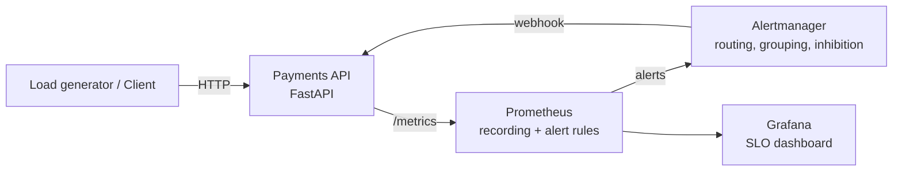

# Payments API: SRE Observability & Reliability Demo


A small payments microservice built and operated the SRE way: **SLOs, error budgets, burn-rate alerting, golden-signal dashboards, runbooks, chaos testing, and production-ready Kubernetes manifests**.

## Architecture



## What this project demonstrates

| SRE concept | Where |
|-------------|-------|
| Golden signals / RED metrics (rate, errors, duration, saturation) | `app/main.py` |
| Liveness vs readiness vs startup probes | `app/main.py`, `k8s/deployment.yaml` |
| Structured JSON logs with request-ID correlation | `app/main.py` |
| SLIs, SLOs, error budget policy | `docs/slo.md` |
| Recording rules + multi-window, multi-burn-rate alerts | `monitoring/prometheus/rules/` |
| Alert routing, grouping, inhibition | `monitoring/alertmanager/alertmanager.yml` |
| Dashboards as code | `monitoring/grafana/` |
| Runbooks linked from alerts | `docs/runbook.md` |
| Blameless postmortems | `docs/postmortem-template.md`, `docs/incident-example.md` |
| Chaos / fault injection | `/admin/chaos`, `scripts/chaos.sh` |
| Zero-downtime deploys, HPA, PDB, pod hardening | `k8s/` |
| CI: lint, tests, config validation, image scanning, smoke test | `.github/workflows/ci.yml` |

## Quick start

Requirements: Docker + Docker Compose, Python 3.12 (for tests/load script).

```bash
git clone https://github.com/YOUR_USERNAME/sre-payments-observability.git
cd sre-payments-observability
make up            # build & start the whole stack
```

| Service | URL |
|---------|-----|
| Payments API docs | http://localhost:8000/docs |
| Prometheus | http://localhost:9090 |
| Alertmanager | http://localhost:9093 |
| Grafana (admin/admin) | http://localhost:3000 |

Try the API:
```bash
curl -X POST localhost:8000/api/payments -H 'Content-Type: application/json' \
  -d '{"amount":250,"currency":"USD","from_account":"ACC-1001","to_account":"ACC-2002"}'
```

## Demo: break it and watch the alerts fire

```bash
make load            # terminal 1: steady traffic (~20 rps)
make chaos-errors    # terminal 2: 30% of requests now fail
```
1. Grafana: availability drops, 5xx rate spikes.
2. Prometheus → *Alerts*: `PaymentsErrorBudgetFastBurn` goes **pending → firing** (~2–3 min).
3. Alertmanager routes it to the `oncall-pager` receiver.
4. `make logs` shows the `ALERT received` log line (stand-in for PagerDuty).
5. Follow `docs/runbook.md` → `make chaos-off` → alert resolves.

Try `make chaos-latency` for the p99 latency alert.

## Run tests
```bash
make install && make test
```

## Deploy to Kubernetes (kind / minikube)
```bash
docker build -t ghcr.io/YOUR_USERNAME/sre-payments-observability:1.0.0 .
kind load docker-image ghcr.io/YOUR_USERNAME/sre-payments-observability:1.0.0   # if using kind
make k8s-apply
kubectl get pods -n payments
```

## Design decisions
- **Health checks excluded from the SLI**: only `/api/*` traffic reflects user experience.
- **4xx don't burn budget**: they are client errors, not service failures.
- **Burn-rate alerts instead of static thresholds**: page only when the SLO is actually threatened, which reduces alert fatigue.
- **`maxUnavailable: 0` + readiness probe + `preStop` sleep**: in-flight requests are drained during rollouts.
- **PDB `minAvailable: 2`**: node maintenance can't take the service below quorum.

## Roadmap
- [ ] Distributed tracing with OpenTelemetry + Jaeger
- [ ] Persist payments in PostgreSQL and add a dependency check to readiness
- [ ] Auth + environment guard for `/admin/*`
- [ ] Terraform for cloud infrastructure
- [ ] Canary deployments with Argo Rollouts, gated on SLO metrics
